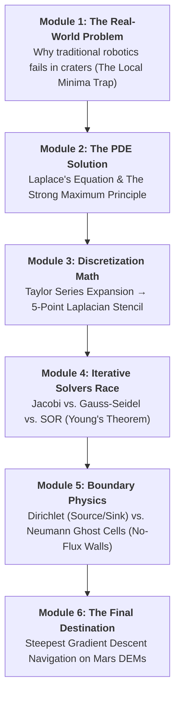
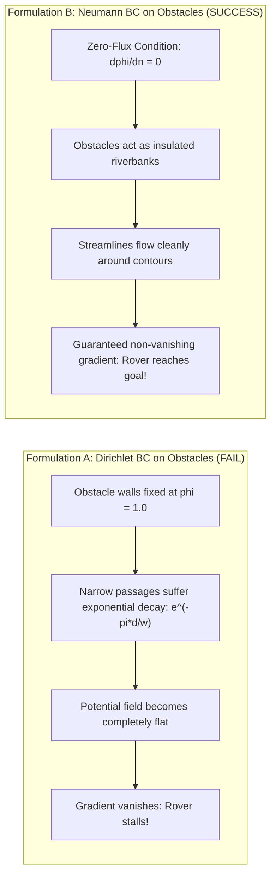

# 🎓 PDE Rover Engine: A Mini-Course in Applied PDEs & Planetary Robotics

Welcome to your college **Partial Differential Equations (PDE)** team project!

This guide is designed as an interactive **mini-course**. It takes you from the pure mathematical theory of elliptic PDEs all the way to autonomous rover navigation on real NASA HiRISE elevation models of Mars.

> 💡 **Where to code:** You only need to write code in **one single file**:  
> [`rover_path_finder/solvers.py`](rover_path_finder/solvers.py)  
> All other components (terrain loaders, path descend planners, Dijkstra benchmarks, and visualization engines) are already implemented and waiting for your solvers!

---

## 📚 Course Curriculum at a Glance



---

## 🪐 Module 1: The Real-World Problem (Why We Need PDEs)

Imagine an autonomous planetary rover on Mars (or the Moon) tasked with driving from a landing site to an exploration target.

### The Classic Approach: Artificial Potential Fields (APF)
In traditional video games and classical robotics, developers use an intuitive idea called **Artificial Potential Fields (APF)**:
1. The **Goal** exerts an *attractive gravitational force* pulling the rover in: $U_{\text{att}}(x) \propto \|x - x_{\text{goal}}\|^2$.
2. Every **Obstacle** exerts a *repulsive electrostatic force* pushing the rover away: $U_{\text{rep}}(x) \propto \frac{1}{d(x)^2}$.
3. Total potential: $U(x) = U_{\text{att}}(x) + U_{\text{rep}}(x)$. The rover rolls downhill along $-\nabla U$.

### The Fatal Flaw: The Local Minimum Trap 🪤
Consider a U-shaped crater or a dead-end canyon:
- As the rover enters the canyon heading toward the goal behind the back wall, the forward pull toward the goal is **exactly balanced** by the backward repulsion from the crater wall.
- Result: $\nabla U = \mathbf{0}$. The forces cancel out!
- The rover enters a **local minimum** and becomes permanently stuck in a trap, rocking back and forth or freezing forever.

**How do we fix this?** We need a mathematical field that is *physically incapable* of forming interior potholes or local traps. That field is governed by **Laplace's Equation**.

---

## 📐 Module 2: The Core PDE Theory (Harmonic Functions)

We replace ad-hoc heuristic forces with a fundamental equation of physics and mathematics: **Laplace's Equation** in 2D:

$$\nabla^2\phi = \frac{\partial^2\phi}{\partial x^2} + \frac{\partial^2\phi}{\partial y^2} = 0$$

Any smooth function $\phi(x, y)$ that satisfies Laplace's equation is called a **harmonic function**. Harmonic functions possess two extraordinary mathematical properties that make them ideal for path planning:

### 1. The Mean Value Property
For any point $(x_0, y_0)$ in the domain and any circle of radius $R$ centered at $(x_0, y_0)$ inside the domain:
$$\phi(x_0, y_0) = \frac{1}{2\pi R} \oint_{\partial B_R} \phi(s) \, ds$$
> **In plain English:** The value at *any* point is strictly equal to the arithmetic average of the values in its immediate neighborhood.

### 2. The Strong Maximum (and Minimum) Principle
> **Theorem:** Let $\phi$ be harmonic in a connected open domain $\Omega$. If $\phi$ attains a local maximum or minimum in the interior of $\Omega$, then $\phi$ must be constant everywhere.

**Why this matters for our rover:**
- If $\phi$ is non-constant, **local minima CANNOT exist inside the domain**!
- Extrema can **only occur on the boundary**:
  - We set the start position as a high-potential source: $\phi = 1.0$.
  - We set the goal target as the lowest-potential sink: $\phi = 0.0$.
- Because no interior local minima can exist, gradient descent ($-\nabla\phi$) is **mathematically guaranteed to guide the rover to the goal without ever getting stuck**, no matter how complex the maze of craters is!

---

## 🧮 Module 3: Discretization Math (Taylor Series to 5-Point Stencil)

Computers cannot solve continuous differential equations directly on continuous space. We must discretize the 2D plane into a grid with spacing $\Delta x = \Delta y = h$.

### The Taylor Series Derivation
Let's approximate $\frac{\partial^2\phi}{\partial x^2}$ at grid point $(i, j)$ using Taylor series:

$$\phi(x + h, y) = \phi_{i+1, j} = \phi_{i,j} + h \left.\frac{\partial\phi}{\partial x}\right|_{i,j} + \frac{h^2}{2}\left.\frac{\partial^2\phi}{\partial x^2}\right|_{i,j} + \frac{h^3}{6}\left.\frac{\partial^3\phi}{\partial x^3}\right|_{i,j} + \mathcal{O}(h^4)$$

$$\phi(x - h, y) = \phi_{i-1, j} = \phi_{i,j} - h \left.\frac{\partial\phi}{\partial x}\right|_{i,j} + \frac{h^2}{2}\left.\frac{\partial^2\phi}{\partial x^2}\right|_{i,j} - \frac{h^3}{6}\left.\frac{\partial^3\phi}{\partial x^3}\right|_{i,j} + \mathcal{O}(h^4)$$

Notice what happens when we **add** these two equations together:
- The first-order derivatives $h \frac{\partial\phi}{\partial x}$ cancel out!
- The third-order derivatives $\frac{h^3}{6} \frac{\partial^3\phi}{\partial x^3}$ cancel out!
- We are left with:
  $$\phi_{i+1, j} + \phi_{i-1, j} = 2\phi_{i,j} + h^2 \left.\frac{\partial^2\phi}{\partial x^2}\right|_{i,j} + \mathcal{O}(h^4)$$

Rearranging gives the second-order central difference approximation:
$$\left.\frac{\partial^2\phi}{\partial x^2}\right|_{i,j} = \frac{\phi_{i+1, j} - 2\phi_{i,j} + \phi_{i-1, j}}{h^2} + \mathcal{O}(h^2)$$

Applying the exact same derivation in the $y$-direction:
$$\left.\frac{\partial^2\phi}{\partial y^2}\right|_{i,j} = \frac{\phi_{i, j+1} - 2\phi_{i,j} + \phi_{i, j-1}}{h^2} + \mathcal{O}(h^2)$$

### The 5-Point Discrete Laplacian
Now substitute both into Laplace's equation $\nabla^2\phi = 0$:
$$\frac{\phi_{i+1, j} - 2\phi_{i,j} + \phi_{i-1, j}}{h^2} + \frac{\phi_{i, j+1} - 2\phi_{i,j} + \phi_{i, j-1}}{h^2} = 0$$

Multiply the entire equation by $h^2$:
$$(\phi_{i+1, j} + \phi_{i-1, j} + \phi_{i, j+1} + \phi_{i, j-1}) - 4\phi_{i,j} = 0$$

Solving for the center node $\phi_{i,j}$:
$$\phi_{i,j} = \frac{1}{4}\left(\phi_{i+1, j} + \phi_{i-1, j} + \phi_{i, j+1} + \phi_{i, j-1}\right)$$

> **Key Takeaway:** The continuous Mean Value Property turns directly into the discrete 5-point stencil: **every cell is simply the average of its 4 orthogonal neighbours!**

---

## 🏎️ Module 4: The Numerical Solvers Race (Why 3 Solvers?)

On a $100 \times 100$ terrain map, we have up to $10,000$ interconnected grid cells. This forms a massive linear system:
$$A \mathbf{\Phi} = \mathbf{b}$$
Where $A$ is a $10,000 \times 10,000$ sparse matrix.
- Direct Gaussian elimination would require $\mathcal{O}(M^3) = \mathcal{O}(10^{12})$ operations — far too slow and memory-intensive!
- Instead, we use **iterative relaxation methods**. We start with an initial guess and repeatedly sweep through the grid until the solution converges.

### 1. Jacobi Iteration (The Baseline)
At iteration step $k+1$, every cell is updated simultaneously using values from step $k$:
$$\phi_{i,j}^{(k+1)} = \frac{1}{4}\left(\phi_{i+1,j}^{(k)} + \phi_{i-1,j}^{(k)} + \phi_{i,j+1}^{(k)} + \phi_{i,j-1}^{(k)}\right)$$
- **Why it's slow:** Potential information only moves **one grid cell per sweep**.
- For an $N \times N$ grid, the spectral radius of the iteration matrix is $\rho_J = \cos(\pi / N) \approx 1 - \frac{\pi^2}{2N^2}$.
- To reduce error by a factor of $\epsilon$, Jacobi requires $\mathcal{O}(N^2)$ iterations. For $N=160$, this takes over **21,000 iterations**!

### 2. Gauss-Seidel Relaxation (Use fresh information immediately)
Instead of waiting for the next sweep, Gauss-Seidel uses freshly computed values as soon as they become available:
$$\phi_{i,j}^{(k+1)} = \frac{1}{4}\left(\phi_{i+1,j}^{(k)} + \phi_{i-1,j}^{(k+1)} + \phi_{i,j+1}^{(k)} + \phi_{i,j-1}^{(k+1)}\right)$$
- **Performance:** As proved by the Gauss-Seidel theorem, spectral radius $\rho_{\text{GS}} = \rho_J^2$, which cuts the required iteration count **cleanly in half** ($\sim 12,000$ sweeps).

### 3. Successive Over-Relaxation (SOR) with Young's Theorem 🚀
Why settle for taking tiny steps toward the equilibrium average? We can **extrapolate** (over-relax) in the direction of the correction:
$$\phi_{i,j}^{(k+1)} = (1 - \omega)\phi_{i,j}^{(k)} + \omega \cdot \phi_{i,j}^{\text{avg}}$$
- If $\omega = 1.0$: This is standard Gauss-Seidel.
- If $1.0 < \omega < 2.0$: Over-relaxation accelerates convergence.
- **Young's Theorem:** For a 2-cyclic consistently ordered matrix, the optimal parameter is:
  $$\omega_{\text{opt}} = \frac{2}{1 + \sqrt{1 - \rho_J^2}} = \frac{2}{1 + \sqrt{1 - \cos^2(\pi/N)}} = \frac{2}{1 + \sin(\pi/N)}$$
- **Performance:** Iteration count drops from $\mathcal{O}(N^2)$ down to $\mathcal{O}(N)$. For $N=160$, SOR finishes in **only 322 sweeps** — a **66x speedup**!

### Why Red-Black Ordering? (Vectorization in NumPy)
Sequential Gauss-Seidel updates cell $(i, j)$ using $(i-1, j)$, which normally forces slow nested `for` loops in Python.
- Notice that the 5-point stencil only couples cells with **opposite parity**: $(i+j) \pmod 2$.
- We color the grid like a chessboard into **Red** (even) and **Black** (odd) sets.
- Red cells depend ONLY on Black neighbours. Black cells depend ONLY on Red neighbours!
- This enables **100% vectorized array slicing in NumPy** without any race conditions!

---

## 🧱 Module 5: Boundary Physics (Dirichlet vs. Neumann Walls)

A PDE is completely defined by its **Boundary Conditions (BCs)**. How we handle obstacle walls determines whether our rover navigates successfully or fails completely!



### The Failure of Formulation A (Dirichlet Obstacles)
If you treat obstacle walls as fixed potential $\phi = 1.0$ (hoping high potential pushes the rover away):
- In any narrow pass of width $w$ and length $d$, the potential decays exponentially as:
  $$\phi(x) \propto e^{-\pi d / w}$$
- Over a long corridor, $\phi$ drops to machine precision ($10^{-16}$). The potential becomes completely flat ($0.00000000$), the gradient vanishes ($\nabla\phi \approx \mathbf{0}$), and the rover has no slope to follow!

### The Triumph of Formulation B (Zero-Flux Neumann Walls)
Instead of forcing potential on obstacles, we declare obstacles to be **perfectly insulated boundaries** where no flux can enter or leave:
$$\frac{\partial\phi}{\partial n} = \nabla\phi \cdot \hat{\mathbf{n}} = 0$$

#### The Ghost Cell Derivation
At a wall boundary $x = x_0$, approximate the normal derivative with a central difference using a fictitious **ghost cell** $\phi_{-1}$ inside the obstacle:
$$\left.\frac{\partial\phi}{\partial x}\right|_{x_0} \approx \frac{\phi_1 - \phi_{-1}}{2h} = 0 \implies \phi_{-1} = \phi_1$$

Substitute $\phi_{-1} = \phi_1$ back into the 5-point discrete Laplacian stencil:
$$\phi(x_0, y) = \frac{\phi_1 + \phi_{-1} + \phi_{\text{up}} + \phi_{\text{down}}}{4} = \frac{2\phi_1 + \phi_{\text{up}} + \phi_{\text{down}}}{4}$$

On an arbitrary terrain grid, this reflection condition means: **the obstacle cell is simply excluded, and we average over only the $c_{i,j} \in \{1, 2, 3, 4\}$ active free neighbours that exist!**

---

## 🎯 Module 6: The Final Destination (What We End Up With)

Once your PDE solver converges, you have computed a smooth 2D potential field $\phi(x, y)$ across the entire planet surface.

### 1. Steepest Descent Navigation
The rover determines its next step $(x_{k+1}, y_{k+1})$ by simply rolling downhill along the negative gradient:
$$\mathbf{v} = -\nabla\phi(x, y)$$
On our discrete 8-connected grid, the rover looks at all 8 surrounding cells and steps to whichever reachable neighbor has the lowest $\phi$ value.

### 2. What the Output Proves (Your Project Deliverables)
When you run the project, your team will see:
1. **Convergence study (`fig3_validation_and_solvers.png`):** Validates second-order accuracy against the analytical solution $\phi = \frac{\sin(\pi x)\sinh(\pi y)}{\sinh(\pi)}$.
2. **Never-stuck test:** Tests 400 random starting positions across lunar terrain — 400 out of 400 safely reach the goal.
3. **Trap test (`fig4_trap_comparison.png`):** Demonstrates side-by-side how classic APF gets trapped inside a U-shaped dead end, while Laplace Formulation B smoothly maneuvers out and around to the goal.
4. **Real Mars Missions:** Real-world paths through HiRISE Mars elevation models (Opportunity landing site and Kasei Valles canyon).

---

## 🛠️ Module 7: Hands-On Laboratory Guide (How to Code & Test)

### Setup
```bash
# 1. Install dependencies
uv sync
```

### Where to Code
Open [`rover_path_finder/solvers.py`](rover_path_finder/solvers.py). Implement the 4 functions in order:

1. **`omega_opt(N)`**: Calculate the optimal relaxation factor formula.
2. **`jacobi(phi, fixed, tol, maxit)`**: Simultaneous 4-neighbor averaging.
3. **`sor(phi, fixed, omega, tol, maxit)`**: Red-Black checkerboard SOR.
4. **`sor_neumann(phi, fixed, free, omega, tol, maxit)`**: No-flux Neumann walls on obstacles.

### Testing in 0.1 Seconds
Use the dedicated fast test bench as you build:
```bash
# Test Phase 1 (omega_opt, jacobi, sor):
uv run python test_solvers.py --phase 1

# Test Phase 2 (sor_neumann):
uv run python test_solvers.py --phase 2

# Test all functions:
uv run python test_solvers.py
```

### Full Simulation & Report Generator
Once all unit tests pass, run the full pipeline:
```bash
uv run python main.py
```
This generates all figures in `outputs/` and reproduces the full project benchmarks!

---

## 📊 Module 8: How to Read the Terminal Output

When you run `uv run python main.py`, look for these mathematical confirmations:

```text
== Validation against the exact solution (Laplace on the unit square) ==
N=  16  max error = 1.109e-03
N=  32  max error = 2.780e-04  (ratio to previous = 3.99)
N=  64  max error = 6.963e-05  (ratio to previous = 3.99)
N= 128  max error = 1.741e-05  (ratio to previous = 4.00)
```
> **PDE Milestone:** The error ratio is **4.00**, confirming that our spatial discretization achieves true **second-order spatial accuracy $\mathcal{O}(h^2)$** ($2^2 = 4$).

```text
== Iterations needed to reach tol=1e-6 ==
N= 160  Jacobi= 21356  Gauss-Seidel= 12477  SOR= 322
```
> **Numerical Analysis Milestone:** SOR converges in **322 iterations**, compared to 21,356 for Jacobi — demonstrating the power of Young's over-relaxation theorem!

```text
Trap test (U-shaped dead end):
Classic potential field: reached goal = False (stuck at (52, 50))
Laplace (formulation B): reached goal = True (path length 110.3 cells)
```
> **Robotics & Physical Milestone:** Concrete proof that the Maximum Principle eliminates local traps!
