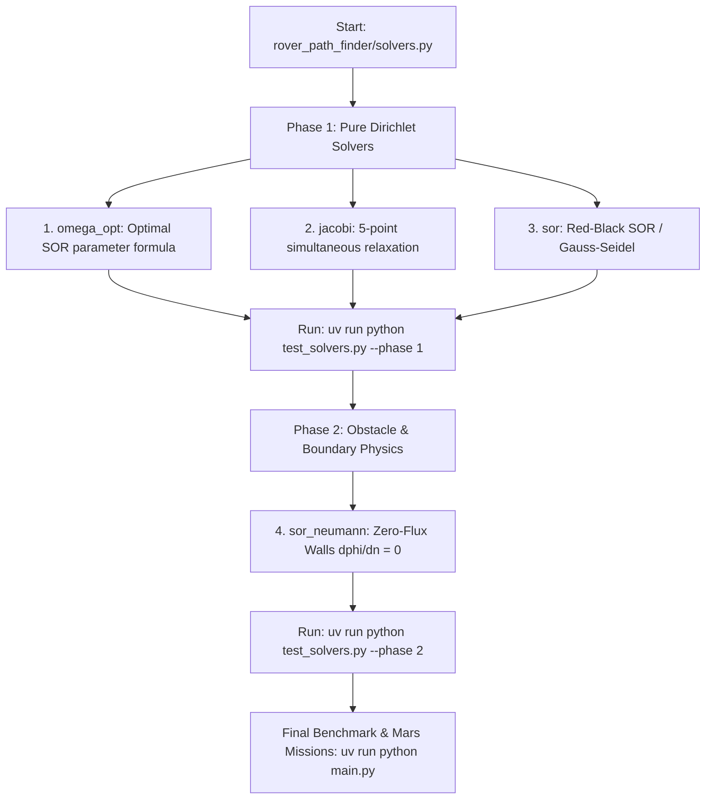

# 🚀 PDE Rover Engine: Team Project & Solver Guide

Welcome to our college **Partial Differential Equations (PDE)** team project!

This repository contains the complete simulation, benchmarking, and real Mars Digital Elevation Model (DEM) navigation engine for an autonomous planetary rover guided by **Laplace's Equation ($\nabla^2\phi = 0$)**.

> 💡 **Where to code:** You only need to write code in **one single file**:  
> [`rover_path_finder/solvers.py`](rover_path_finder/solvers.py)  
> All other components (terrain loaders, path descend planners, Dijkstra benchmarks, and visualization engines) are already implemented and waiting for your solvers!

---

## 📖 1. Why Laplace's Equation? (The Physics & Math)

Traditional robot path planners often use **Artificial Potential Fields (APF)**, where a goal attracts the rover and obstacles repel it. However, APF suffers from a major mathematical flaw: **local minima**. In dead ends or U-shaped obstacles, attractive and repulsive forces cancel out, leaving the rover permanently stuck.

### The Maximum Principle: Guaranteed No Local Minima
In our project, we model navigation using **harmonic functions** that satisfy Laplace's equation in 2D:
$$\nabla^2\phi = \frac{\partial^2\phi}{\partial x^2} + \frac{\partial^2\phi}{\partial y^2} = 0$$

By the **Strong Maximum (and Minimum) Principle** of elliptic PDEs:
- A non-constant harmonic function on a connected domain **cannot attain a local maximum or minimum in the interior**.
- Extrema can **only occur on the boundary** (at our start source $\phi=1.0$ and target sink $\phi=0.0$).
- Therefore, performing **steepest gradient descent** ($-\nabla\phi$) from any point in the navigable space is mathematically guaranteed to reach the target without ever stalling!

---

## ⚡ 2. Quickstart Setup

We use [`uv`](https://github.com/astral-sh/uv), an ultra-fast Python package and environment manager.

### Step 1: Install `uv` (if not already installed)
- **Windows (PowerShell):**
  ```powershell
  powershell -ExecutionPolicy ByPass -c "irm https://astral.sh/uv/install.ps1 | iex"
  ```
- **macOS / Linux:**
  ```bash
  curl -LsSf https://astral.sh/uv/install.sh | sh
  ```

### Step 2: Install dependencies
In the project root folder, run:
```bash
uv sync
```
This automatically configures a virtual environment with `numpy`, `matplotlib`, and `pillow`.

---

## 🗺️ 3. The 2-Phase Roadmap

Open [`rover_path_finder/solvers.py`](rover_path_finder/solvers.py). You will find 4 functions marked with `# TODO: YOUR CODE HERE`.



### Phase 1: Pure Dirichlet Solvers & Analytical Validation
In this phase, you solve Laplace's equation on a square unit domain with fixed boundary values.

1. **`omega_opt(N)`**:
   - Compute the theoretical optimal relaxation factor:
     $$\omega_{\text{opt}} = \frac{2}{1 + \sin(\pi / N)}$$
2. **`jacobi(phi, fixed, tol, maxit)`**:
   - Standard Jacobi iteration. Every interior node is updated simultaneously using the mean of its 4 orthogonal neighbours:
     $$\phi_{i,j}^{(k+1)} = \frac{1}{4} \left(\phi_{i+1,j}^{(k)} + \phi_{i-1,j}^{(k)} + \phi_{i,j+1}^{(k)} + \phi_{i,j-1}^{(k)}\right)$$
   - Cells with `fixed == True` retain their Dirichlet values.
3. **`sor(phi, fixed, omega, tol, maxit)`**:
   - Red-Black Successive Over-Relaxation.
   - When $\omega = 1.0$, this is Gauss-Seidel.
   - When $1 < \omega < 2$, over-relaxation dramatically accelerates convergence.
   - Using a checkerboard decomposition (Red: $(i+j)\%2==0$, Black: $(i+j)\%2==1$) allows **100% vectorized updates in NumPy without slow Python for-loops!**

### Phase 2: Obstacle Handling with Zero-Flux Neumann Walls
Terrain obstacles (craters, steep slopes, boulder fields) must block the rover.

4. **`sor_neumann(phi, fixed, free, omega, tol, maxit)`**:
   - Why not set $\phi = 1$ on obstacles (Formulation A)? Because in narrow passes, Dirichlet walls cause exponential potential decay ($e^{-\pi d / w}$), flattening the gradient and leaving the rover stuck.
   - **Formulation B (Neumann Walls):** We enforce zero-flux across obstacle boundaries:
     $$\frac{\partial\phi}{\partial n} = 0$$
   - Discrete meaning: obstacle cells do not absorb or supply potential. The 5-point stencil only averages across the *navigable* (`free`) neighbours that actually exist ($c_{i,j} \in \{1, 2, 3, 4\}$):
     $$\phi_{i,j}^{(k+1)} = (1 - \omega)\phi_{i,j}^{(k)} + \omega \frac{\sum_{\text{free neighbours}} \phi_{\text{nbr}}}{c_{i,j}}$$

---

## 🧪 4. How to Test Your Code

We have created two ways to test your implementations:

### Method A: Fast Unit Test Bench (Recommended during development)
Instead of running the full 30-second simulation every time, use `test_solvers.py` to test your functions in **0.1 seconds**:

```bash
# Test only Phase 1 functions:
uv run python test_solvers.py --phase 1

# Test only Phase 2 (sor_neumann):
uv run python test_solvers.py --phase 2

# Test everything:
uv run python test_solvers.py
```

### Method B: Full System Benchmark & Report Figure Generator
Once `test_solvers.py` passes all checks, run the main benchmark:
```bash
uv run python main.py
```

This runs:
1. **Convergence order study:** Validates error against the exact analytical solution $\phi(x,y) = \frac{\sin(\pi x)\sinh(\pi y)}{\sinh(\pi)}$.
2. **Solver speed race:** Compares iteration counts for Jacobi vs. Gauss-Seidel vs. SOR.
3. **Synthetic lunar terrain run:** Generates optimal path vs. Dijkstra shortest path.
4. **Never-stuck test:** Solves paths from 400 random starting cells across rugged terrain.
5. **Concave trap test:** Proves that Laplace Formulation B escapes the U-trap where APF fails.

All visual figures will be generated and saved to `outputs/`:
- `fig1_terrain.png` — Lunar terrain slope & hazard dilation map.
- `fig2_solution_and_path.png` — Potential field streamlines and rover route.
- `fig3_validation_and_solvers.png` — $O(h^2)$ numerical error curve & iteration comparison.
- `fig4_trap_comparison.png` — U-shaped trap side-by-side comparison (APF vs. Laplace).

---

## 📊 5. How to Read the Console Output

When running `uv run python main.py`, look for these key mathematical milestones:

```text
== Validation against the exact solution (Laplace on the unit square) ==
N=  16  max error = 1.109e-03
N=  32  max error = 2.780e-04  (ratio to previous = 3.99)
N=  64  max error = 6.963e-05  (ratio to previous = 3.99)
N= 128  max error = 1.741e-05  (ratio to previous = 4.00)
```
> **What this means:** The error ratio is **4.00**, proving that our 5-point finite difference discretization has **second-order spatial accuracy $O(h^2)$** ($2^2 = 4$).

```text
== Iterations needed to reach tol=1e-6 ==
N= 160  Jacobi= 21356  Gauss-Seidel= 12477  SOR= 322
```
> **What this means:** SOR converges in **322 iterations**, compared to 21,356 for Jacobi — a **66x speedup**!

```text
Never-stuck test: steepest descent on phi_B reached the target from 400 of 400 random reachable cells
```
> **What this means:** Experimental verification of the Maximum Principle in complex geometry!

---

## 🪐 6. Bonus: Real Mars Missions on NASA/HiRISE DTMs

Our repository already includes real Mars HiRISE terrain data in `data/`! Once your solvers work, you can plan paths across real Martian craters:

```bash
# Plan a route across Opportunity Rover landing site (Eagle Crater):
uv run python plan_on_heightmap.py data/opportunity.IMG --max-slope 20 --rover-radius 5 --palette mars --out outputs/opportunity

# Plan a long-range route through Kasei Valles outflow channel:
uv run python plan_on_heightmap.py data/kasei.IMG --start 250 500 --goal 2400 5800 --max-slope 25 --rover-radius 20 --palette mars --out outputs/kasei
```

---

## 🧮 7. Helpful Mathematical Cheatsheet

### 1. Vectorized 5-Point Stencil in NumPy
Instead of slow nested `for i in range(ny): for j in range(nx):` loops, use `np.roll` to shift the 2D array:
```python
def _avg(phi):
    return 0.25 * (
        np.roll(phi,  1, axis=0) +  # phi[i-1, j]  (down)
        np.roll(phi, -1, axis=0) +  # phi[i+1, j]  (up)
        np.roll(phi,  1, axis=1) +  # phi[i, j-1]  (right)
        np.roll(phi, -1, axis=1)    # phi[i, j+1]  (left)
    )
```

### 2. Red-Black Parity Mask
To vectorize SOR:
```python
ny, nx = phi.shape
yy, xx = np.mgrid[0:ny, 0:nx]
parity = (xx + yy) % 2
# Red cells: parity == 0
# Black cells: parity == 1
```

### 3. Neumann Free Neighbour Count
To compute $c_{i,j}$ for no-flux walls:
```python
f = free.astype(float)
cnt = (
    np.roll(f, 1, axis=0) + np.roll(f, -1, axis=0) +
    np.roll(f, 1, axis=1) + np.roll(f, -1, axis=1)
)
cnt = np.maximum(cnt, 1.0)  # avoid division by zero in hazard pockets
```

---

## 📁 8. Project Structure Summary

```text
├── TEAM_GUIDE.md               ← You are here! Complete guide for teammates
├── test_solvers.py             ← Fast unit test bench (uv run python test_solvers.py)
├── main.py                     ← Complete numerical benchmark & figure runner
├── plan_on_heightmap.py        ← High-level planner for real Mars DEMs
├── pyproject.toml              ← Project dependencies & environment configuration
├── data/                       ← Real Mars HiRISE DEM data files (.IMG)
│   ├── opportunity.IMG         ← Opportunity landing site (8.6 MB)
│   └── kasei.IMG               ← Kasei Valles channel (81.3 MB)
├── outputs/                    ← Generated plots and logs (.gitkeep)
├── solutions/                  ← Backed up working reference solution
│   └── solvers_reference.py    ← Reference key
└── rover_path_finder/
    ├── solvers.py              ← ✏️ THE ONLY FILE YOU NEED TO EDIT!
    ├── terrain.py              ← Synthetic lunar terrain & DEM parser
    ├── planners.py             ← Gradient descent navigator & APF comparison
    └── visualization.py        ← Topographic contour & vector plotting
```
